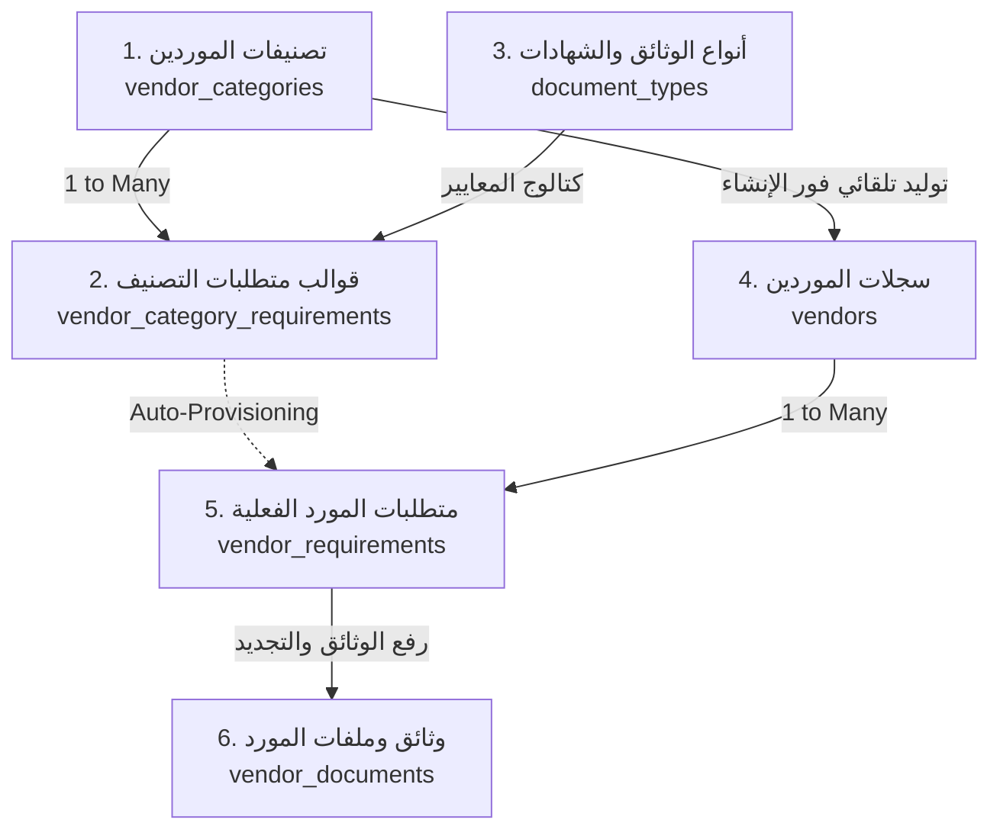

# 🛡️ VendorProof — منصة امتثال واعتماد الموردين والشهادات
> **Enterprise Multi-Tenant SaaS Platform for Supplier Compliance, Document Verification & Risk Governance**

<p align="center">
  
  
  
  
  
  
  
  
</p>

---

## 📑 فهرس المحتويات (Table of Contents)

1. [عن المنصة (About VendorProof)](#-عن-المنصة-about-vendorproof)
2. [المعمارية الهندسية الموديلية (Modular Architecture)](#-المعمارية-الهندسية-الموديلية-modular-architecture)
3. [محرك الامتثال الذكي وأركانه الستة (Core Compliance Engine)](#-محرك-الامتثال-الذكي-وأركانه-الستة-core-compliance-engine)
4. [الميزات والقدرات التشغيلية (Key Features)](#-الميزات-والقدرات-التشغيلية-key-features)
5. [واجهات الـ RESTful API والتوثيق التفاعلي (API Documentation)](#-واجهات-الـ-restful-api-والتوثيق-التفاعلي-api-documentation)
6. [نظام وهوية التصميم (Design System Standards)](#-نظام-وهوية-التصميم-design-system-standards)
7. [متطلبات التشغيل والبيئة (Prerequisites)](#-متطلبات-التشغيل-والبيئة-prerequisites)
8. [دليل التثبيت والتشغيل المحلي (Quickstart Guide)](#-دليل-التثبيت-والتشغيل-المحلي-quickstart-guide)
9. [الاختبارات وضمان الجودة (Testing & QA)](#-الاختبارات-وضمان-الجودة-testing--qa)
10. [هيكلية المجلدات (Directory Structure)](#-هيكلية-المجلدات-directory-structure)

---

## 💡 عن المنصة (About VendorProof)

**VendorProof** هي منصة سحابية مؤسسية ذكية (B2B SaaS Multi-Tenant Platform) متخصصة في **حوكمة سلاسل الإمداد، وإدارة مخاطر الموردين، وتدقيق الوثائق والتراخيص النظامية والشهادات المهنية**.

تمكّن المنصة المنشآت والشركات (Tenants) من:
- تصنيف الموردين وفق قطاعاتهم ونشاطاتهم التجارية.
- فرض سياسات واشتراطات امتثال آلية لكل تصنيف.
- توليد مهام ومتطلبات الامتثال للمورد فور ربطه بالنظام تلقائياً (**Auto-Provisioning**).
- متابعة نسبة الامتثال الحية لحظياً (**Live Compliance Score**).
- إدارة الإعفاءات والاستثناءات الإدارية المسببة نظامياً (**Administrative Waivers**).
- فحص واعتماد الوثائق المرفوعة بسجلات تدقيق تاريخية غير قابلة للتضارب.

---

## 🏛️ المعمارية الهندسية الموديلية (Modular Architecture)

تعتمد المنصة على معمارية هجينة وموديلية عمودية صارمة تقسم النظام إلى نطاقين تشغيليين مستقلين داخل `app/Modules/` بدون أي مجلدات مصطنعة:

```text
app/
├── Modules/
│   ├── Web/                  ◄── موديول إدارة المنصة والمالك (Super Admin Domain)
│   │   ├── Http/Controllers/
│   │   ├── Http/Requests/
│   │   ├── Models/           (Admin, Plan, PlanPrice, Feature, Subscription)
│   │   ├── Services/
│   │   ├── Database/
│   │   └── routes/web.php
│   │
│   └── Api/                  ◄── محرك الأداة وواجهات التطبيق المفصول (Headless Engine)
│       ├── Http/Controllers/ (ApiController Base Contract)
│       ├── Http/Requests/
│       ├── Models/           (User, Vendor, VendorCategory, DocumentType, ...)
│       ├── Database/
│       └── routes/api.php    (Prefix: /api/v1/)
│
├── Models/                   ◄── الكيانات المشتركة الطبيعية (50% - 50%)
│   ├── Tenant.php            (المنشأة المشتركة)
│   └── Scopes/TenantScope.php (سكوب العزل التلقائي)
└── Traits/
    ├── BelongsToTenant.php   (الحقن والعزل التلقائي للمستأجر)
    └── HasPlanFeatures.php   (حوكمة حدود وميزات الباقات)
```

### 1. موديول الويب وإدارة المنصة (`app/Modules/Web/`)
- مخصص **حصراً لمالك المنصة وإدارتها العليا (Super Admin / Platform Admin)**.
- إدارة المنشآت المشتركة (Tenants Lifecycle).
- إدارة خطط وباقات الاشتراك (Plans, Pricing Matrix, Feature Quotas).
- معالجة المدفوعات والاشتراكات عبر Stripe.
- لوحة تحكم مخصصة تعتمد على جلسات الويب القياسية وقوالب Blade بنظام هوية فاخر وتصميم عريض Fluid 100%.

### 2. موديول محرك الأداة والواجهات البرمجية (`app/Modules/Api/`)
- مخصص **للمنشآت المشتركة والفرونت إند المستقل تماماً (Headless / Decoupled Frontend)**.
- واجهات RESTful API خفيفة وعالية الكفاءة تخضع لعقد استجابة موحد عبر `ApiController`.
- مصادقة رقمية مشفرة بالرموز الموثقة (Laravel Sanctum Bearer Tokens).
- عزل كامل للبيانات وفق تقنية Multi-Tenancy الآلية.

---

## ⚙️ محرك الامتثال الذكي وأركانه الستة (Core Compliance Engine)

يقوم المحرك على **الفصل المعماري الصارم بين "المتطلب النظامي" و"الوثيقة المادية"**، وتتكامل فيه 6 جداول رئيسية:



| الجدول | الوصف والوظيفة | العمليات والخصائص |
| :--- | :--- | :--- |
| **`vendor_categories`** | تصنيفات ونشاطات الموردين (توريد، مقاولات، استشارات). | CRUD كامل، عزل للمنشأة، ربط تلقائي. |
| **`document_types`** | كتالوج الوثائق والتراخيص النظامية (سجل تجاري، شهادة زكاة، آيزو). | أكواد معيارية، تصنيف دورية الصلاحية. |
| **`vendor_category_requirements`** | قوالب سياسات الامتثال الخاصة بكل تصنيف. | تحديد الإلزامية (`is_mandatory`) وإرشادات الرفع. |
| **`vendors`** | بيانات وسجلات الموردين المعتمدين والمحتملين. | ربط التصنيف، جهة الاتصال، السجل التجاري، حالة الاعتماد. |
| **`vendor_requirements`** | قائمة التكاليف والمتطلبات الفعلية للمورد. | التوليد التلقائي، الاستثناء الإداري (`waive`/`unwaive`)، حساب نسبة الامتثال الحية. |
| **`vendor_documents`** | مستودع الملفات المرفوعة وسجلات التحقق والتدقيق. | أرشفة التجديدات وتدقيق الذكاء الاصطناعي وتاريخ الانتهاء. |

---

## ✨ الميزات والقدرات التشغيلية (Key Features)

- 🔒 **عزل المستأجرين بنسبة 100% (Zero-Leak Multi-Tenancy)**:
  - عزل الاستعلامات تلقائياً عبر `TenantScope` و `BelongsToTenant`.
  - التحقق الصارم من فرادة الحقول على مستوى المنشأة فقط وليس على مستوى كامل النظام.
- ⚡ **التأسيس الذري الثلاثي للمنشآت (Atomic Provisioning)**:
  - إنشاء المنشأة، وتعيين المدير المسؤول، وتفعيل الاشتراك الأولي كعملية ذرية واحدة عبر `DB::transaction`.
- 🔄 **الأتمتة الذكية لمتطلبات الموردين (Auto-Provisioning Engine)**:
  - فور تسجيل المورد وربطه بتصنيف معين، يقوم النظام تلقائياً بتوليد سجلات المتطلبات دون أي تدخل يدوي.
- 📊 **احتساب نسبة الامتثال اللحظية (Live Dynamic Scoring)**:
  - حساب فوري لعدد المتطلبات الكلية، المستوفاة، المتبقية، والمعفاة ونسبة الامتثال الإجمالية مع كل تحديث.
- 🛡️ **نظام الإعفاءات والاستثناءات الإدارية المسببة**:
  - إمكانية استثناء متطلب لمورد معين مع تدوين السبب وتاريخ الإعفاء إدارياً مع دعم التراجع الآمن.
- 💳 **حوكمة الباقات وحدود الاستخدام المتقدمة (Plan Limits & Quotas)**:
  - دعم الحدود الرقمية وغير المحدودة (`-1`) وفحص الصلاحيات عبر سمة `HasPlanFeatures`.
- 📚 **توثيق واجهات تفاعلي مدمج**:
  - واجهة Swagger / OpenAPI تلقائية تفاعلية مدعومة بحزمة **Dedoc Scramble**.

---

## 📡 واجهات الـ RESTful API والتوثيق التفاعلي (API Documentation)

### 📖 التوثيق التفاعلي المباشر (Interactive API Docs)
المنصة مزودة بنظام توثيق واجهات تفاعلي مباشر يمكنك تصفحه وتجربة الطلبات منه عبر الرابط:
```text
http://localhost:8000/docs/api
```

### 🛣️ ملخص المسارات الأساسية (API Endpoints Overview)

| الوظيفة / النطاق | الطريقة | المسار (Endpoint) | المصادقة المطلوبة |
| :--- | :---: | :--- | :---: |
| **فحص جاهزية النظام** | `GET` | `/api/ping` | عام (Public) |
| **عرض باقات الاشتراك** | `GET` | `/api/v1/plans` | عام (Public) |
| **تسجيل منشأة جديدة** | `POST` | `/api/v1/register` | خاضع للتقييد (Throttle) |
| **تسجيل الدخول** | `POST` | `/api/v1/login` | خاضع للتقييد (Throttle) |
| **بيانات المستخدم الحالي** | `GET` | `/api/v1/me` | Sanctum Bearer Token |
| **ملف المنشأة والشركة** | `GET/PUT`| `/api/v1/company` | Sanctum Bearer Token |
| **تفاصيل الاشتراك** | `GET` | `/api/v1/subscription` | Sanctum Bearer Token |
| **بدء عملية الدفع والترقية** | `POST` | `/api/v1/subscription/checkout` | Sanctum Bearer Token |
| **إلغاء الاشتراك والعودة للمجاني** | `POST` | `/api/v1/subscription/cancel` | Sanctum Bearer Token |
| **إدارة تصنيفات الموردين** | `CRUD` | `/api/v1/vendor-categories` | Sanctum Bearer Token |
| **إدارة أنواع الوثائق** | `CRUD` | `/api/v1/document-types` | Sanctum Bearer Token |
| **قوالب متطلبات التصنيف** | `CRUD` | `/api/v1/vendor-categories/{id}/requirements` | Sanctum Bearer Token |
| **إدارة سجلات الموردين** | `CRUD` | `/api/v1/vendors` | Sanctum Bearer Token |
| **متطلبات المورد ونسبة الامتثال**| `GET` | `/api/v1/vendors/{vendor}/requirements` | Sanctum Bearer Token |
| **مزامنة متطلبات المورد** | `POST` | `/api/v1/vendors/{vendor}/sync-requirements` | Sanctum Bearer Token |
| **استثناء متطلب لمورد** | `POST` | `/api/v1/vendor-requirements/{id}/waive` | Sanctum Bearer Token |
| **إلغاء استثناء متطلب** | `POST` | `/api/v1/vendor-requirements/{id}/unwaive` | Sanctum Bearer Token |
| **استقبال إشعارات Stripe** | `POST` | `/api/v1/stripe/webhook` | توقيع Stripe Signature |

---

## 🎨 نظام وهوية التصميم (Design System Standards)

تم بناء لوحة تحكم الإدارة وفق فلسفة تصميم منصات الـ SaaS العالمية (Stripe, Linear, Supabase) ومكافحة التصاميم العشوائية:

- **الخط الرسمي**: `IBM Plex Sans Arabic` لجميع العناوين والنصوص.
- **الأيقونات الرسمية**: مكتبة `Remix Icon` حصرياً عبر الفكتور (مع حظر تام للإيموجي في الواجهات الإدارية).
- **التخطيط الفاخر**: هيكل عريض بنسبة 100% بدون هوامش ميتة (Fluid Full-Width Shell) مع تثبيت الشريط العلوي والقائمة الجانبية وحصر التمرير في المحتوى الأوسط.
- **الوضع الليلي الفاخر (High-Contrast Dark Mode)**:
  - ألوان Zinc-950 مع خلفيات كربونية عميقة `#09090b` وأسطح فحمية `#121316`.
  - تطبيق معيار **Inverted Primary CTA** (أزرار بيضاء ناصعة بنصوص كربونية داكنة) لأعلى تباين ممكن.
- **نظام التنبيهات Notyf**: تنبيهات تفاعلية عائمة مدمجة في أعلى اليسار مع دعم RTL كامل وخالية من البنرات الثابتة المزعجة.
- **صفر تنسيقات مضمنة (Zero Inline Styles)**: كافة التنسيقات مركزية ومنظمة داخل `public/css/admin.css`.

---

## 💻 متطلبات التشغيل والبيئة (Prerequisites)

- **PHP**: `^8.2` مع الامتدادات الأساسية (`bcmath`, `curl`, `mbstring`, `openssl`, `pdo_mysql`, `tokenizer`, `xml`).
- **Composer**: `^2.2` فما فوق.
- **قاعدة البيانات**: `MySQL 8.0+` أو `PostgreSQL 14+` أو `SQLite` للبيئات التجريبية.
- **خادم الويب**: `Nginx` أو `Apache` أو الخادم المحلي لـ PHP / Artisan.

---

## 🚀 دليل التثبيت والتشغيل المحلي (Quickstart Guide)

### 1. استنساخ المشروع وتثبيت الاعتماديات
```bash
git clone https://github.com/Mohammed-Alssadi/VendorProof-saas-admin.git
cd VendorProof-saas-admin
composer install
```

### 2. إعداد ملف البيئة والمفتاح السري
```bash
cp .env.example .env
php artisan key:generate
```

### 3. ضبط إعدادات قاعدة البيانات
قم بفتح ملف `.env` وضبط بيانات الاتصال بقاعدة البيانات:
```env
DB_CONNECTION=mysql
DB_HOST=127.0.0.1
DB_PORT=3306
DB_DATABASE=vendorproof_db
DB_USERNAME=root
DB_PASSWORD=your_password
```

### 4. تشغيل الترحيلات والبذور الأولية
```bash
php artisan migrate --seed
```

### 5. ربط مستودع التخزين وتشغيل خادم التطوير
```bash
php artisan storage:link
php artisan serve
```

### 6. تسجيل الدخول للوحة التحكم
- **رابط الدخول**: `http://localhost:8000/login`
- **البريد الافتراضي للمشرف**: `admin@vendorproof.sa`
- **كلمة المرور الافتراضية**: `Password123!`

---

## 🧪 الاختبارات وضمان الجودة (Testing & QA)

تخضع كافة أجزاء وموديولات المنصة لحزمة اختبارات آلية صارمة تغطي سيناريوهات الأمان، وعزل الـ Multi-Tenancy، والتحقق من البيانات:

### تشغيل طقم الاختبارات الشامل:
```bash
php artisan test
```

### تشغيل اختبارات موديول أو ميزة معينة:
```bash
# اختبارات متطلبات الموردين ومحرك الامتثال
php artisan test --filter=VendorRequirementApiTest

# اختبارات أنواع الوثائق
php artisan test --filter=DocumentTypeApiTest

# اختبارات إدارة الموردين
php artisan test --filter=VendorApiTest

# اختبارات طلبات التحقق والحوكمة
php artisan test --filter=FormRequestValidationTest
```

### فحص وتنسيق الكود وفق معايير Laravel Pint:
```bash
./vendor/bin/pint --test
```

> **حالة الاختبارات الحالية**: `148 passed (663 assertions)` بنسبة نجاح **100%**.

---

## 📂 هيكلية المجلدات (Directory Structure)

```text
VendorProof-saas-admin/
├── app/
│   ├── Models/                     # الكيانات المشتركة (Tenant, Payment)
│   ├── Modules/
│   │   ├── Api/                    # موديول الأداة ومحرك الامتثال (Headless API)
│   │   │   ├── Database/Migrations/
│   │   │   ├── Http/Controllers/   # ApiController, Vendors, Documents, Requirements
│   │   │   ├── Http/Requests/      # FormRequests المخصصة للـ API
│   │   │   ├── Models/             # Vendor, DocumentType, VendorRequirement...
│   │   │   ├── Providers/          # ApiModuleServiceProvider
│   │   │   └── routes/api.php      # مسارات API المقيدة بـ /api/v1/
│   │   │
│   │   └── Web/                    # موديول لوحة تحكم الإدارة (Super Admin)
│   │       ├── Database/           # Migrations & Seeders الخاصة بلوحة الإدارة
│   │       ├── Http/Controllers/   # Tenants, Plans, Subscriptions, Payments
│   │       ├── Http/Requests/      # FormRequests المخصصة للويب
│   │       ├── Models/             # Admin, Plan, PlanPrice, Feature, Subscription
│   │       ├── Providers/          # WebModuleServiceProvider
│   │       ├── Services/           # PlanService
│   │       └── routes/web.php      # مسارات الويب ولوحة التحكم
│   │
│   ├── Services/                   # الخدمات الأساسية (TenantService, StripePaymentService)
│   └── Traits/                     # سمات العزل وفحص الميزات (BelongsToTenant, HasPlanFeatures)
│
├── database/                       # الترحيلات والبذور المركزية
├── public/                         # الأصول وملفات التنسيق (css/admin.css)
├── resources/views/                # قوالب Blade للوحة المشرف العام
├── routes/                         # المسارات الأساسية
└── tests/                          # حزمة الاختبارات الآلية (Feature & Unit)
```

---

## 📄 الترخيص (License)

هذا المشروع ملكية خاصة ومطور كمنصة سحابية متقدمة (**Proprietary Enterprise SaaS Platform**). جميع الحقوق محفوظة لمنصة **VendorProof**.
